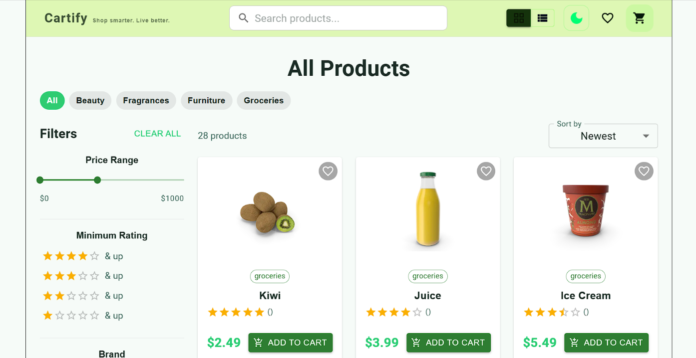
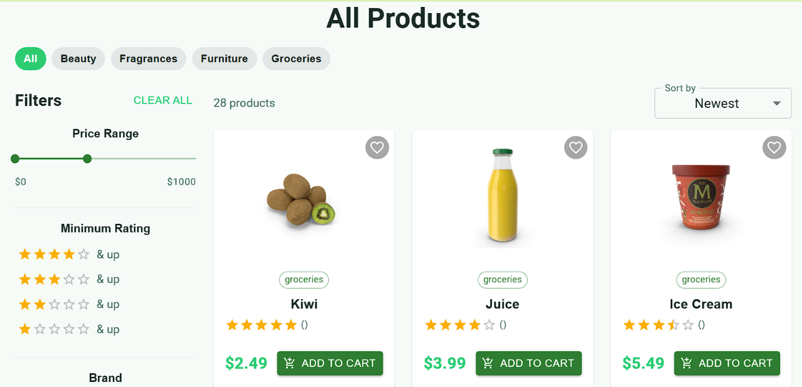
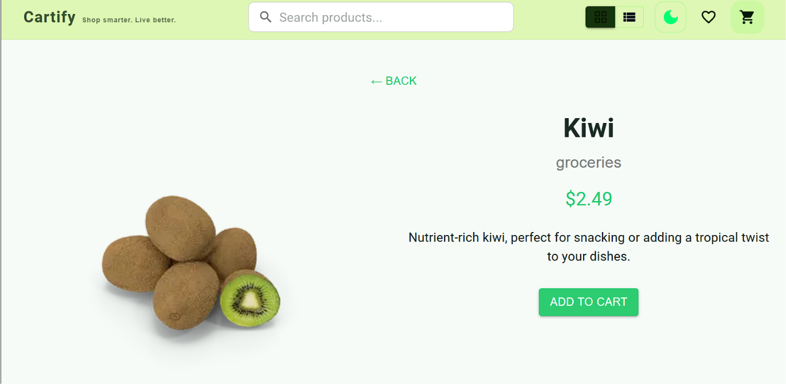
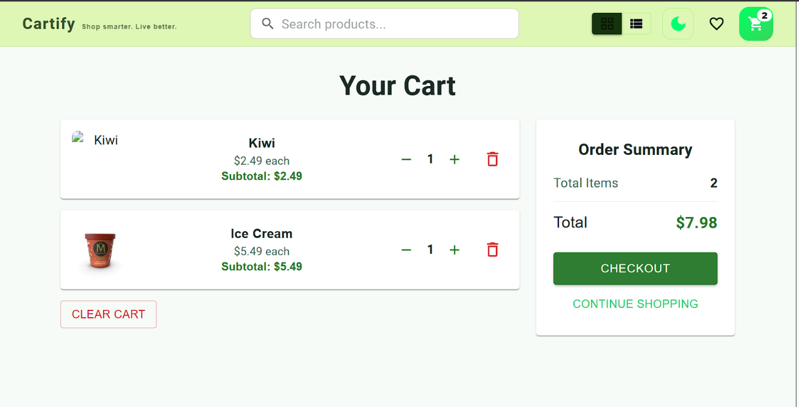

# 🛒 Cartify (React E-Commerce App)

A modern, full-featured e-commerce front end built with **React**, demonstrating real-world patterns for state management (**Context API, Redux Toolkit, React Query**), a complete multi-step checkout flow, product discovery (search, filtering, sorting, pagination), a persistent wishlist, and performance/SEO best practices.

---

## 🚀 Features

### 🧠 State Management

- **Context API + useReducer**
  - Theme toggle (Dark / Light mode)
  - Layout switch (Grid / List view)

- **Redux Toolkit**
  - Cart: add, remove, increase/decrease quantity, clear cart, total price & item count tracking
  - Wishlist: add, remove, toggle, clear — persisted to `localStorage`

- **React Query** (`@tanstack/react-query`)
  - Fetch products from the API (cached, shared across pages — e.g. Home and the search bar reuse the same cache)
  - Fetch a single product by ID (Product Details page)
  - Built-in loading and error states, retry on demand

---

## 📦 Pages

- **Home** — product listing with search, filters, sorting, and pagination
- **Product Details** — full product info, add to cart, add to wishlist
- **Cart** — review items, adjust quantities, proceed to checkout
- **Checkout** — 5-step guided flow (new)
- **Order Confirmation** — post-checkout summary and mock tracking (new)
- **Wishlist** — saved products with quick actions (new)

---

## 🧾 Multi-Step Checkout (new)

A 5-step guided checkout, each step validated before the user can continue:

1. **Contact Information** — email, phone
2. **Shipping** — first/last name, address, city, province, postal code, country
3. **Delivery** — Standard (Free), Express ($12), Next Day ($25), with dynamic delivery-time estimates
4. **Payment** — mock payment form (card number, MM/YY, CVC, name on card) with a live card preview, input auto-formatting, and card-brand detection. **This is frontend-only — no real payment is ever processed, transmitted, or stored.**
5. **Review** — full order summary, shipping address, delivery method, masked payment method, and total, before placing the order

Extras:
- Form progress is cached in `sessionStorage`, so an accidental page refresh mid-checkout won't wipe out what the user already typed
- Redirects back to the cart automatically if checkout is reached with an empty cart

### ✅ Order Confirmation 

After a mock order is placed:
- Success screen with a generated order ID (e.g. `#ORD-2026-84721`)
- Dynamically estimated delivery window based on the chosen delivery method
- **Track Order** — opens a mock shipment-status timeline
- **Continue Shopping** — returns to the catalog

---

## 🔍 Product Discovery

- View all products from the API
- Filter by category (chip selector)
- **Search**  — live suggestions dropdown as you type, recent search history saved to `localStorage`, a "Clear history" action, and a friendly no-results state
- **Advanced Filtering**  — price range slider, minimum rating, brand (multi-select), and "in stock only" availability toggle, available as a sidebar on desktop and a slide-out drawer on mobile
- **Advanced Sorting**  — Newest, Price: Low → High, Price: High → Low, Rating
- **Pagination**  — product grid/list is paginated instead of rendering everything at once
- View full product details
- Add products to cart directly from a card or the details page

---

## ❤️ Wishlist 

- Add/remove products via a heart icon on product cards and the details page
- Dedicated **Wishlist** page listing all saved items
- **Move to Cart** — moves an item from the wishlist straight into the cart
- **Remove** individual items or **Clear Wishlist** entirely
- Live wishlist count badge in the navbar
- Persisted to `localStorage`, so it survives page refreshes and browser restarts

---

## 🎨 UI Features

- Responsive design (mobile + desktop)
- Grid / List view toggle
- Dark / Light mode
- Modern Material UI design
- Consistent **loading**, **error**, and **empty** states across every page (product grid, cart, wishlist, product details, search) instead of blank screens or silent failures

---

## ⚡ Performance & SEO

- **Code splitting** — Cart, Product Details, Wishlist, Checkout, and Order Confirmation are all lazy-loaded (`React.lazy` + `Suspense`), so the initial bundle only ships what's needed for the home page
- **Lazy-loaded images** (`loading="lazy"`, `decoding="async"`) across product cards, cart, wishlist, and product details
- **Memoization** — `ProductCard` is wrapped in `React.memo`; filtering/sorting/pagination results are memoized with `useMemo` to avoid unnecessary recalculation
- **Debounced search input** to avoid re-filtering on every keystroke
- **Cached API requests** via React Query, shared between the Home page and the search bar (no duplicate network calls)
- **Skeleton loading state** for the product grid on first load, avoiding layout jump
- **Dynamic SEO** — a lightweight custom `useSEO` hook sets a per-page document title, meta description, canonical URL, and Open Graph tags (no extra dependency required)

---

## 🛠️ Tech Stack

- React (Vite)
- React Router DOM
- Context API
- Redux Toolkit
- React Query (`@tanstack/react-query`)
- Material UI (MUI)
- DummyJSON API

---

## 🌐 API Used

- https://dummyjson.com/products

---


## 📁 Project Structure

```text
Cartify/
│
├── Screenshots/                  # Application screenshots
│   ├── Home.png
│   ├── Product Details.png
│   ├── Products.png
│   └── Shopping cart.png
│
├── public/                       # Static assets
│   ├── favicon.svg
│   └── icons.svg
│
├── src/
│   │
│   ├── Api/
│   │   └── productApi.js         # Product API requests and data fetching
│   │
│   ├── Layout/
│   │   └── Layout.jsx            # Common application layout
│   │
│   ├── assets/                   # Images and static assets
│   │   ├── hero.png
│   │   ├── react.svg
│   │   └── vite.svg
│   │
│   ├── components/               # Reusable UI components
│   │   ├── checkout/             # Checkout form steps
│   │   │   ├── StepContact.jsx
│   │   │   ├── StepDelivery.jsx
│   │   │   ├── StepPayment.jsx
│   │   │   ├── StepReview.jsx
│   │   │   └── StepShipping.jsx
│   │   │
│   │   ├── common/               # Common UI states
│   │   │   ├── EmptyState.jsx
│   │   │   ├── ErrorState.jsx
│   │   │   └── LoadingState.jsx
│   │   │
│   │   ├── products/             # Product display and controls
│   │   │   ├── ProductCard.jsx
│   │   │   ├── ProductFilters.jsx
│   │   │   ├── ProductPagination.jsx
│   │   │   └── ProductSort.jsx
│   │   │
│   │   ├── search/
│   │   │   └── SearchBar.jsx     # Product search and suggestions
│   │   │
│   │   ├── wishlist/
│   │   │   └── WishlistButton.jsx # Wishlist actions
│   │   │
│   │   └── NavBar.jsx            # Main navigation bar
│   │
│   ├── context/
│   │   └── ThemeContext.jsx      # Light and dark theme management
│   │
│   ├── features/                 # Redux state management
│   │   ├── WishlistSlice.js      # Wishlist state and actions
│   │   ├── cartSlice.js          # Shopping cart state and actions
│   │   └── store.js              # Redux store configuration
│   │
│   ├── hooks/                    # Custom React hooks
│   │   ├── useDebounce.js        # Delayed search execution
│   │   ├── useLocalStorage.js    # Browser localStorage management
│   │   ├── useSEO.js             # Page SEO metadata management
│   │   └── useSearchHistory.js   # Search history management
│   │
│   ├── pages/                    # Main application pages
│   │   ├── CartPage.jsx          # Shopping cart page
│   │   ├── CheckoutPage.jsx      # Checkout page
│   │   ├── Home.jsx              # Homepage
│   │   ├── OrderConfirmation.jsx # Order confirmation page
│   │   ├── ProductDetails.jsx    # Product details page
│   │   └── WishlistPage.jsx      # Wishlist page
│   │
│   ├── utils/                    # Utility and helper functions
│   │   ├── checkoutValidation.js # Checkout form validation
│   │   └── format.js             # Data and currency formatting
│   │
│   ├── App.css                   # Application-level styles
│   ├── App.jsx                   # Main component and routing
│   ├── index.css                 # Global styles
│   └── main.jsx                  # React application entry point
│
├── .gitattributes                # Git file attributes configuration
├── .gitignore                   # Files excluded from Git
├── README.md                     # Project documentation
├── eslint.config.js              # ESLint configuration
├── index.html                    # HTML entry point
├── package-lock.json             # Dependency lock file
├── package.json                  # Project dependencies and scripts
└── vite.config.js                # Vite configuration
```

### 📌 Folder Description

| Folder | Description |
|---|---|
| `Screenshots/` | Contains application screenshots for project documentation. |
| `public/` | Stores static files such as favicon and SVG icons. |
| `Api/` | Handles product API requests and data fetching. |
| `Layout/` | Defines the common application layout. |
| `assets/` | Contains images and other static resources. |
| `components/` | Contains reusable UI components. |
| `context/` | Manages global theme settings using Context API. |
| `features/` | Manages cart and wishlist state using Redux Toolkit. |
| `hooks/` | Contains reusable custom React hooks. |
| `pages/` | Contains the main application pages. |
| `utils/` | Contains reusable helper and validation functions. |

### ⚙️ Main Application Files

- **main.jsx:** Initializes the React application.
- **App.jsx:** Manages the main application structure and routing.
- **App.css:** Contains application-specific styling.
- **index.css:** Defines global styles.
- **package.json:** Contains project dependencies and scripts.
- **vite.config.js:** Configures the Vite development and build environment.


---

## ▶️ Getting Started

```bash
# install dependencies
npm install

# start the dev server
npm run dev

# build for production
npm run build

# preview the production build
npm run preview
```


# Cartify
### Shop smarter. Live better.

## Screenshots

### 1. Homepage


### 2. Product Listing


### 3. Product Details


### 4. Shopping Cart

